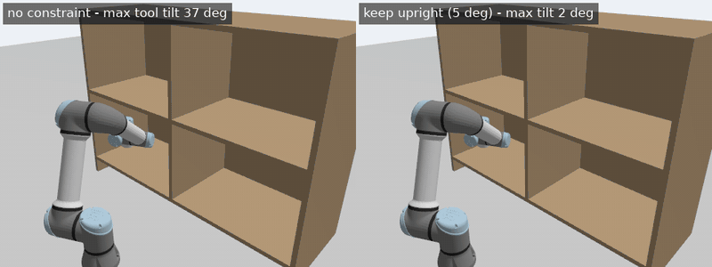
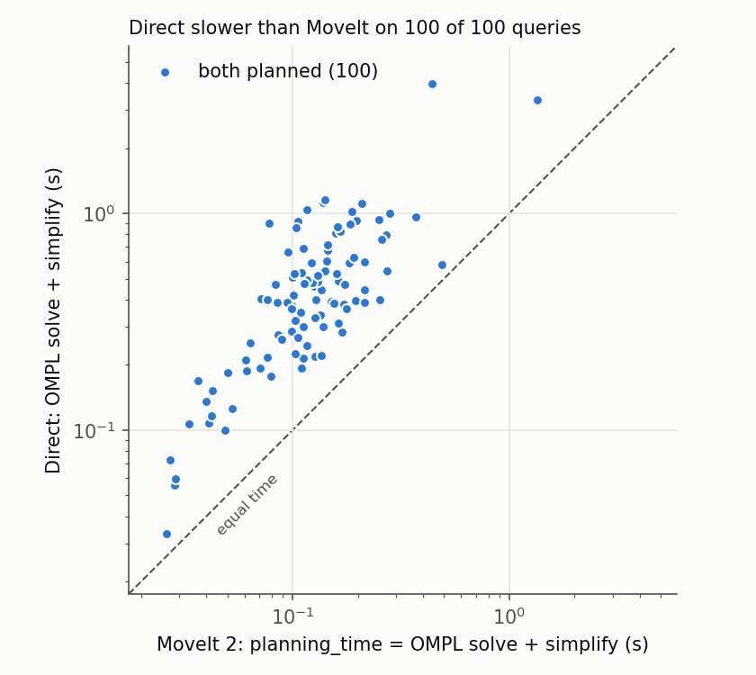

# pointcloud-constrained-planning

[](https://github.com/giridhar-shenoy/pointcloud-constrained-planning/actions/workflows/ci.yml)



*One evaluation query (rule: the lowest id that crosses compartments and was solved under both
constraints within the median time; here query 5, upper right to lower left), re-planned and
executed in Gazebo, recorded by a simulated camera with headless rendering. The
label is each path's measured max tool tilt. Played 15× slower than the time-optimal trajectory,
shown at 3× ([scripts/record_gifs.sh](scripts/record_gifs.sh)).*

A UR5e in Gazebo plans through a shelf that MoveIt 2 only knows from an octomap built live from a
simulated RGB-D camera: a C++ benchmark node (MoveItCpp) runs 100 seeded, IK-sampled shelf queries
with OMPL's RRTConnect, unconstrained and with a "keep the cup upright" orientation constraint
solved in OMPL's constrained (projected) state space. v0.2 plans the same queries again with a
pipeline written directly on OMPL, Pinocchio/coal and a trapezoidal parameteriser, executes both
on the same controller, and measures what MoveIt's machinery costs and whether the two collision
checkers agree. Every number below comes from a CSV through a script, with Wilson confidence
intervals.

**Language split:** C++17 for everything on the planning path (benchmark nodes, constraint builder,
query generator, metrics, and the whole direct pipeline); Python for launch files, test
orchestration, aggregation and plots.

## Run it

```bash
# ROS 2 Lyrical + the apt packages listed in the Dockerfile, then:
colcon build --symlink-install && source install/setup.bash
scripts/bench_planners.sh 5 results/tmp/bench5.csv   # sim + octomap + 5-query benchmark, ~2 min
scripts/bench_direct.sh 5 results/tmp/d5.csv --plan-only  # v0.2: direct vs MoveIt, no Gazebo, ~10 s
scripts/collision_agreement.sh 50 results/tmp/a50.csv      # v0.2: FCL vs coal, no Gazebo, ~10 s
scripts/regenerate_all.sh                             # every number and GIF in this README
```

On another ROS distro, use the devcontainer or the `Dockerfile` (base `ros:lyrical-ros-base`).

## Results (v0.1: 100 seeded shelf queries, 10 s per plan, 1 repetition)

<!-- results:start -->
<!-- generated by scripts/aggregate.py -->

| Planner | Constraint | Success (95 % Wilson CI) | Planning time median / p95 (s) | Joint path median (rad) | TCP path median (m) | Max tool tilt median / worst (deg) | Executed path collision-free (dense check) |
|---|---|---|---|---|---|---|---|
| RRTConnect (range 2 rad) | none | 100/100 = 100 % (96 %–100 %) | 0.375 / 0.781 | 4.94 | 1.10 | 54.5 / 133.7 | 94/100 |
| RRTConnect (range 2 rad) | orientation | 79/100 = 79 % (70 %–86 %) | 2.215 / 7.348 | 5.86 | 1.80 | 1.4 / 4.1 | 79/79 |
| BiTRRT (range 2 rad) | none | 0/100 = 0 % (0 %–4 %) | – / – | – | – | – / – | not recorded |
| BiTRRT (range 2 rad) | orientation | 83/100 = 83 % (74 %–89 %) | 2.195 / 8.591 | 5.34 | 1.47 | 1.3 / 4.3 | 82/83 |

Source: `results/bench.csv + results/bench_bitrrt.csv` (400 rows, 100 queries, commit `00e1d72`, query seed 0, OMPL seed 1, modes `constrained_state_space`, `joint_space`, 10 s per cell, octomap 4747 occupied 2 cm voxels, total wall time 8.2 min).

<!-- results:end -->

Full tables, the per-query-class breakdown and plots are in [docs/results.md](docs/results.md);
planner and constraint settings are in [docs/planners.md](docs/planners.md); the node/topic graph
is in [docs/architecture.md](docs/architecture.md).

## Direct OMPL + coal pipeline vs MoveIt 2 on the same queries (v0.2)

The same 100 shelf queries planned twice: once by MoveIt 2 (MoveItCpp, as v0.1, but on the box
shelf instead of the octomap), once by a pipeline written directly on the libraries in C++17:
Pinocchio + coal for collision checking, OMPL's RRTConnect and path simplifier, R1's trapezoidal
time parameterisation and a FollowJointTrajectory client. It answers what MoveIt's machinery
costs over OMPL and a collision checker used directly, and whether two collision checkers agree
on the same scene ([docs/results.md](docs/results.md#collision-agreement-moveits-planning-scene-vs-the-direct-checker)).

<!-- direct-results:start -->
<!-- generated by scripts/aggregate_direct.py -->

| Metric | Direct (OMPL + coal) | MoveIt 2 (MoveItCpp) | Like for like? |
|---|---|---|---|
| Planned (Wilson 95 %) | 100/100 = 100 % (96 %–100 %) | 100/100 = 100 % (96 %–100 %) | yes |
| **OMPL solve + simplification**, median / p95 (s) | 0.402 / 1.039 | 0.123 / 0.274 | **yes**: MoveIt's `planning_time` is solve + simplify |
| OMPL solve only, median / p95 (s) | 0.081 / 0.531 | inside `planning_time` | direct only |
| Simplification, median / p95 (s) | 0.320 / 0.688 | inside `planning_time` | direct only |
| Time parameterisation, median / p95 (s) | 0.000025 / 0.000047 | inside `plan()` (TOTG adapter) | no: trapezoid vs TOTG |
| **Request → time-parameterised trajectory**, median / p95 (s) | 0.402 / 1.040 | 0.169 / 0.471 | **yes**: wall time, same process |
| Validity checks per request, median / p95 | 7668 / 19644 | not exposed | direct only |
| Collision check inside the planner, median over 20 probe queries (µs) | 48.6 | 12.4 | yes: same queries, each measured inside its own planner (probe) |
| Trajectory duration, median / p95 (s) | 3.85 / 6.60 | 3.14 / 5.61 | no: rest-to-rest trapezoids vs TOTG on the interpolated path |
| Joint path length, median (rad) | 4.71 | 4.51 | yes (same metric) |
| TCP path length, median (m) | 1.18 | 1.13 | yes (same metric) |
| Path clean for the OTHER pipeline's checker at 0.01 rad (cross-validation) | 97/100 | 91/100 | yes |
| Path clean for its OWN checker at 0.01 rad | 97/100 | 91/100 | yes (a failure here is a discretisation miss, not a checker disagreement) |
| Executed and reached the goal (≤ 0.01 rad) | 100/100 = 100 % (96 %–100 %) | 99/100 = 99 % (95 %–100 %) | yes: same controller |
| Execution time, median / p95 (sim s) | 3.87 / 6.61 | 3.18 / 5.60 | no: follows the trajectory duration; MoveIt adds its execution manager |
| Max joint tracking error, median / p95 (rad) | 0.0330 / 0.0538 | 0.0457 / 0.0578 | yes: same controller, same measurement |

Source: `results/bench_direct.csv` (200 rows, 100 queries, 0 skipped, commit `5432d60`, query seed 0, OMPL seed 1 (direct only), with execution, 10 s per plan, total wall time 28.2 min). Direct: RRTConnectRange2, range 2.00 rad, check every 0.0207 rad (extent 69.12 rad). MoveIt's configured context: range 2, check every 0.0207 rad (extent 69.12 rad).

<!-- direct-results:end -->



**Two more comparisons on the same queries (plan only, tables in
[docs/results.md](docs/results.md)).** With v0.1's keep-upright constraint in both pipelines (an
`ompl::base::Constraint` on OMPL's `ProjectedStateSpace` for the direct planner), the direct
pipeline plans 58/100 within 10 s against MoveIt's 88/100, with tool tilt at most 1.8° vs 3.2°. On
move_group's octomap (the 4747-voxel map v0.1 used, handed to the direct checker as one
`coal::OcTree`), both plan 100/100 and the planning-time gap shrinks to 1.3× (0.47 s vs 0.37 s
median), because MoveIt's FCL check also gets more expensive against an octree.

**What is identical.** Robot and URDF (the same `robot_description` string), the SRDF's disabled
pairs (both checkers test the same 62 pairs; a unit test compares the sets), the seven shelf boxes
(one YAML, loaded as coal boxes and published to MoveIt as `CollisionObject`s), zero padding,
the planner and its settings (RRTConnect, range 2 rad, `longest_valid_segment_fraction` 0.0003 —
read by the direct planner from MoveIt's own `ompl_planning.yaml`, in a state space that uses
MoveIt's L1 joint metric and extent so those numbers mean the same step and the same 0.021 rad
check spacing), the 10 s timeout, the simplification budget rule (timeout minus planning time),
the velocity and acceleration limits, the controller that executes, and how tracking error is
measured. **What differs.** The collision library (coal through Pinocchio vs MoveIt's default
FCL plugin; coal is a fork of FCL, so they share algorithms); time parameterisation (rest-to-rest
trapezoids at every simplified waypoint vs TOTG on MoveIt's interpolated path); MoveIt's planning
scene monitor, planning context set-up, request/response adapters and trajectory execution
manager, which the direct pipeline does not have. **What MoveIt gives you that the direct pipeline
does not:** live octomap updates from the camera, attached objects, the request/response adapters
(start-state repair, solution validation, time parameterisation), path constraints without
writing them yourself (v0.1's keep-upright), and controller management. **Like for like:** the
success rates, "OMPL solve + simplification" (MoveIt's `planning_time` is exactly that), "request
→ time-parameterised trajectory" (wall time in the same process), path lengths, cross-validation
and tracking error. Not like for like: trajectory duration and execution time (different
parameterisers), and the per-request check counts (MoveIt does not expose them).

## Where it fails

- **Keep-upright planning still fails often.** Holding the tool within 5° of vertical, RRTConnect
  in OMPL's projected state space solves clearly fewer shelf queries in 10 s than unconstrained
  planning (table above), and the gap is largest when the arm has to leave one compartment and
  enter another (per-class table in docs/results.md). The projected space walks a 4-D manifold of
  tool-down configurations, and the compartment openings are narrow passages of it. A MoveIt-side
  contributor I have not verified: the constrained validity checker re-checks the path constraint
  with exact tolerances, while OMPL's projection stops at a 1e-4 residual.
- **BiTRRT is not a drop-in alternative here.** With its range chosen on the constrained tuning
  queries (2 rad), BiTRRT matches RRTConnect on the keep-upright queries but solves none of the
  unconstrained ones in 10 s (table above). My working explanation, not verified: BiTRRT only joins
  its trees when they come within one `range` step in MoveIt's L1 joint metric, while in the
  projected state space the re-projected steps meet more often. A range tuned on unconstrained
  queries was not tried.
- **It is very sensitive to RRTConnect's `range`.** OMPL's automatic range is 20 % of MoveIt's
  joint-space extent, which for the UR5e (±2π joints, extent = sum of ranges = 69 rad) is a
  13.8 rad step. On a separate tuning set it solved 1 of 20 constrained queries; range 2 rad solved
  11 of 20 and is what the benchmark uses (docs/planners.md). Ranges above 2 rad were not tried.
- **Discrete collision checking still misses grazing contacts.** Re-checking every executed
  trajectory at 0.01 rad joint steps finds some successful plans that touch an octomap voxel
  between checked states ("dense check" column above): OMPL checks every ≈ 0.021 rad and
  `ValidateSolution` only the waypoints. A collision-padding margin or continuous collision
  checking would close this; neither is in v0.1.
- **Executing plans in Gazebo needs slow playback.** `gz_ros2_control` tracks position commands
  through a soft proportional loop; time-optimal trajectories lag by 0.2 rad at 2–5× slow-down and
  clip the shelf, so the GIF is played 15× slower. The v0.1 benchmark only plans; v0.2 executes
  both pipelines.
- **The collision-check resolution default is wrong for this arm.** With MoveIt's usual
  `longest_valid_segment_fraction: 0.005` that same 69 rad extent means a motion check only every
  0.35 rad: in the first full run every unconstrained failure was a path that stepped over a 2 cm
  octomap board and was caught by `ValidateSolution` (ablation table in docs/results.md). The
  benchmark uses 0.0003 (≈ 0.021 rad) and re-checks every executed trajectory at 0.01 rad.
- **MoveIt's constrained state space supports a subset of constraints.** At most one position
  constraint (box region only) plus one orientation constraint (rotation-vector parameterization
  only); joint and visibility constraints are not represented. Line and box constraints are not in
  v0.1.
- **The rotation vector couples yaw and tilt.** MoveIt bounds each rotation-vector component, so
  the x/y tolerance is 5°/√2 and the admissible tilt depends on how far the tool has yawed from the
  reference: between ≈ 3.2° and 5° with the reference yaw centred between start and goal, never
  more than 5°. With a fixed reference it would drop to ≈ 2.25° for a tool yawed by 180°.
- **Unconstrained paths would spill the cup.** Without the constraint the tool tilts far from
  vertical on the way (max-tilt column), even though start and goal are both tool-down.
- **Coarser octomaps break queries before they speed planning up.** 2 cm was chosen from the
  thinnest obstacle (2 cm boards). In the 2 cm vs 5 cm sweep (first 20 queries, docs/results.md)
  5 cm voxels put half of the queries' start or goal states in collision, because one voxel
  swallows the generator's 3 cm clearance, while unconstrained planning time barely changes.
- **One fixed camera.** Occluded space is unknown, and MoveIt treats unknown as free: the back
  corners of the compartments behind the boards are not in the map.
- **No sensor noise.** The Gazebo depth camera is noise-free; a real camera's speckle and edge
  artefacts would add phantom voxels next to the shelf.
- **Query generation avoids the hard edges.** Start/goal poses are sampled inside inset
  compartment regions with 3 cm clearance from the shelf, so IK failures at the shelf edges are
  not exercised (the generator's counters are in `results/queries.json`).
- **Not bit-reproducible, and one repetition.** Queries are byte-identical from the seed (tested);
  plans are not, because OMPL stops on wall-clock time. An earlier run of an equivalent
  configuration (commit 4060411's `results/bench.csv`) solved 84 instead of 79 keep-upright
  queries: within the Wilson intervals, but a reminder that one repetition per cell is thin. Seeds
  and the commit hash are stamped on every row.
- **MoveIt 2.15.2's `~MoveItCpp` segfaults on shutdown** in this setup; the node writes its
  outputs and exits with `_Exit` instead.
- **v0.2: the direct pipeline is slower at planning, and it is the collision checker, not
  MoveIt's machinery.** On the same queries with the same OMPL settings, the direct pipeline's
  solve + simplification takes 3.3× MoveIt's `planning_time` (median of per-query ratios). A
  probe that counts MoveIt's own validity checks shows both planners make a similar number of
  checks per request (median 9,564 vs 8,768 over 20 queries), but a check costs 48.6 µs in the
  direct planner and 12.4 µs inside MoveIt's planner (medians). Pinocchio's `computeCollisions` runs coal's
  narrow phase on all 62 active pairs for every state, while MoveIt's FCL environment culls pairs
  with a broadphase first. MoveIt's machinery outside the planner (planning context set-up,
  adapters, TOTG) costs 0.048 s per request (median; p95 0.195 s: `plan()` wall time minus
  `planning_time`), against 0.0003 s for the direct pipeline's parameterisation, which is not
  enough to close the gap: request → trajectory is still 0.402 s direct vs 0.169 s MoveIt. On
  the octomap, where FCL's checks also get expensive, the gap shrinks to 1.3×, consistent with
  this explanation. The fix (coal's broadphase through Pinocchio) is not in v0.2.
- **v0.2: keep-upright planning is weaker in the direct pipeline.** With the same constraint
  definition, the direct planner solves 58/100 queries within 10 s against MoveIt's 88/100
  (solve + simplify median 4.0 s vs 1.0 s). Projection and every motion check along the
  constrained geodesics pay the slower per-check cost. MoveIt's constrained checker also
  re-checks the path constraint at exact tolerance, while mine relies on the projection's 1e-4
  residual: the direct paths tilt at most 1.8°, MoveIt's at most 3.2°.
- **v0.2: simplification dominates direct planning time.** Simplification took longer than the
  OMPL solve on 93 of 100 direct plans. The simplifier is OMPL's (the same
  code as in MoveIt), but every one of its thousands of motion checks pays the per-check cost
  above.
- **v0.2: the two collision checkers disagree only at nanometres.** 500/500 uniform
  configurations agree, but uniform samples never come within millimetres of contact. A
  boundary probe bisected to 1e-7 rad finds 14 of 194 brackets where coal reports contact and
  FCL measures 1–5 nm of separation, all on forearm_link/wrist_3_link. That is below both
  libraries' 1e-6 m GJK tolerance. Coal is a fork of FCL, so this is not independent
  verification of either. Nothing was tuned.
- **v0.2: dense re-checks find discretisation misses, not checker disagreements.** 9 of 100
  MoveIt trajectories fail the direct checker at 0.01 rad, and 3 of 100 direct paths fail
  MoveIt's; on every path the other pipeline's checker
  agrees with the path's own checker. They are discretisation misses: OMPL checks motions every
  0.021 rad (L1) and some segments graze the shelf between checked states; MoveIt's TOTG also
  blends corners between the waypoints `ValidateSolution` checked, as in v0.1.
- **v0.2: execution in Gazebo is not always clean.** In the published run MoveIt's query 63
  aborted when the arm lagged 0.207 rad behind the reference (the controller's path tolerance is
  0.2 rad; its path was collision-free on both dense checks), and one of the direct planner's
  repositioning moves (between queries 91 and 92, not a measured run) aborted the same way; both
  stopped the arm in contact with the shelf. In the first full run such an abort (a MoveIt
  trajectory that grazed the shelf) left the arm in contact, and my harness could not plan away
  from a colliding start, so the run cascaded from query 57 (kept in `results/runs/`). The
  harness now escapes to the nearest collision-free configuration first (2 escapes in the
  published run).
- **v0.2: tracking error.** Max joint tracking error (`/joint_states` vs the controller's own
  reference) is 0.033 / 0.054 rad for the direct trapezoids and 0.046 / 0.058 rad for MoveIt's
  TOTG trajectories (median / p95). Both are within the controller's 0.2 rad path tolerance except
  for the two aborts above (worst MoveIt run 0.207 rad).
- **v0.2: queries skipped: none.** No start or goal was rejected by either checker (the
  generator keeps 3 cm clearance from the boxes).
- **v0.2: MoveIt's plans are not seed-reproducible.** `ompl::RNG::setSeed` seeds the direct
  planner, but MoveIt's state sampler draws from its own `random_numbers` generator.
- **CI does not run the 100-query benchmarks.** GitHub Actions builds the image, runs every unit
  test, the smoke test (headless depth rendering works on the runner's Mesa), the collision
  agreement on 50 configurations and two 5-query mini-benchmarks on every push; the full
  benchmarks need Gazebo for tens of minutes and run locally, stamped with the commit.

## What I'd do next

- v0.2 follow-ups: coal's broadphase (`pinocchio::BroadPhaseManager`) in the direct checker,
  which the probe says is where the planning time goes; BiTRRT, Ruckig or TOTG in the direct
  pipeline; three repetitions per cell for the direct-vs-MoveIt table.
- BiTRRT as a second planner column, a wider `range` sweep, and a 2 cm vs 5 cm octomap
  resolution sweep (same queries).
- Line and box position constraints, rejection-sampling mode as a baseline, PRM, CHOMP/STOMP
  post-processing (and how often it breaks the constraint), three repetitions per cell.
- A dual-arm UR5e configuration and a small task-and-motion-planning layer (PDDL blocks world with
  replanning on failure).
- Depth noise models (or a real camera) and learned samplers for the constrained manifold.
- MIP-based assembly sequencing; pick_ik or TRAC-IK instead of KDL.

## Repository layout

```text
src/pcp_scenes        shelf.yaml (single source of truth) + Gazebo world generator
src/pcp_description   UR5e (ur_simulation_gz) + fixed Gazebo rgbd_camera
src/pcp_moveit_config OMPL (constrained state space), octomap updater, KDL
src/pcp_bringup       sim.launch.py, shelf world, ros_gz bridge, smoke/demo scripts
src/pcp_benchmark     C++: constraint builder, query generator, runner, metrics, gtests
src/pcp_direct        C++ (v0.2): Pinocchio/coal checker, OMPL planner, trapezoids, executor,
                      bench_direct (both pipelines), collision_agreement, box loader, gtests
scripts/              ci_smoke, bench_planners, aggregate, record_gifs, regenerate_all,
                      bench_direct, collision_agreement, aggregate_direct
results/              queries.json, bench.csv (+ .meta.json), summary.json; v0.2:
                      queries_boxes.json, bench_direct.csv, collision_agreement*.csv
```

MIT licensed. Third-party files are listed in [THIRD_PARTY.md](THIRD_PARTY.md).

Written with an AI coding agent working in my terminal; I set the scope, the constraints and the
acceptance criteria, reviewed the changes, and ran every benchmark.
