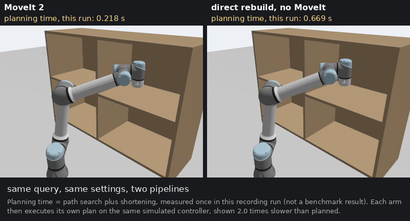
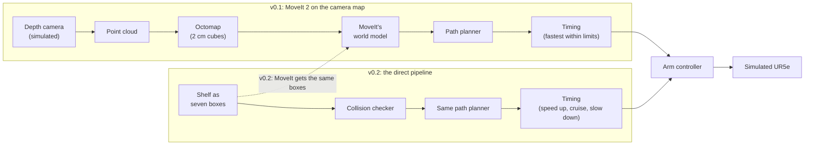
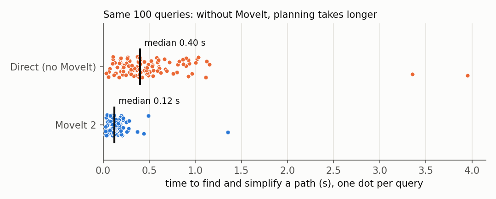

# pointcloud-constrained-planning

[](https://github.com/giridhar-shenoy/pointcloud-constrained-planning/actions/workflows/ci.yml)

A simulated industrial robot arm (a UR5e) looks at a shelf through a depth camera (per-pixel
distance), builds a 3-D map of it, and plans paths into and out of the shelf's compartments, some of
them holding the tool upright as if it carried a full cup. It times how much of the planning time
MoveIt 2, the standard motion-planning framework of ROS 2 (the common open-source robot software
framework), spends in its own software layers around the planning itself, and rebuilds the same
planning without MoveIt for comparison.


*The arm's only knowledge of the shelf is this map, built from the camera's point cloud (the 3-D
points it measures); the path avoids boards it was never told about.*

## What this is

A robot that sees only through a camera must plan around whatever its own map shows, and some tasks
also restrict how the arm may move, such as keeping the tool upright. The usual planners are
sampling-based: they try random configurations (sets of joint angles), and a restriction like that
leaves only a thin sliver of configurations to try.

This is for engineers choosing between MoveIt and planning software of their own. MoveIt wraps OMPL,
the planning library, in layers of its own: a planning scene that tracks the world, adapters that
prepare each request and post-process the result, and the code that receives requests and returns
results. v0.1 plans with MoveIt on an octomap (2 cm occupancy cubes from the point cloud), using
OMPL's RRTConnect (it grows two trees, branching chains of random configurations, one from the start
and one from the goal, until they meet). It plans 100 fixed queries, each a pair of start and goal
poses of the tool (position and orientation), each with and without a keep-upright constraint (tool
within 5° of vertical). v0.2, a second experiment kept alongside the first, plans the same queries
on the shelf given as seven boxes, once through MoveIt (timing its layers from inside MoveIt) and
once with a direct pipeline written straight on OMPL and the collision library coal, to see whether
the planning works without MoveIt and whether the two collision checkers (tests for contact with the
shelf or between the arm's own parts) agree.

What it shows, in simulation and from one run of each benchmark:

<!-- headline:start -->
<!-- generated by scripts/aggregate_direct.py -->

- On the camera's octomap, MoveIt solved every unconstrained query and 79/100 keep-upright ones within 10 s.
- MoveIt's own layers, timed inside MoveIt (everything it does per request outside the planning library, including its adapters and the time parameterisation that gives each point of the path its time), took 0.048 s against 0.123 s of planning, less than half the planning time (medians over the 100 unconstrained queries, with the shelf given as boxes).
- The direct rebuild shows the same planning can be done without MoveIt, but it was about 3× slower (median of per-query ratios), because each of its collision checks costs more (measured); why is a hypothesis: it uses coal instead of FCL (MoveIt's collision library) and tests all 62 pairs of arm parts without a broadphase (a quick pre-filter of far-apart pairs). So its time is not a measure of MoveIt's layers ([Where it fails](#where-it-fails)).
- The two collision checkers: near contact, where configurations were moved step by step to the point where two parts just touch, they gave the same collide / no-collide verdict in 180 of 194 cases; in the other 14 one reports contact and the other a gap of a few nanometres, below the 1e-6 m tolerance coal computes to; on all 500 random configurations they agreed.

<!-- headline:end -->

**Language split:** C++17 for planning, the benchmarks and the direct pipeline; Python for
starting the simulation, tests and plots.

**To run it:** natively on Ubuntu 26.04 with ROS 2's Lyrical release, or in a Docker container (an
isolated, packaged copy of the software environment) built from the included Dockerfile:

```bash
# optional, on any Linux with Docker: open a shell in the container, then run the lines below
docker build -t pcp . && docker run --rm -it -v "$PWD":/ws pcp
rosdep update && rosdep install --from-paths src --ignore-src -y  # system packages the code needs
colcon build && source install/setup.bash  # build; make the built programs usable in this shell
scripts/bench_planners.sh 5 results/tmp/bench5.csv
```

The script launches Gazebo, the robot simulator, and plans five queries; details under
[Run it](#run-it).

## See it


*What to look at: the glass drawn at the tool. Without the constraint (left) it tips over mid-move,
although start and goal are both upright; with keep-upright (right) it stays within 5° of
vertical.*



*What to look at: the printed planning times. Same query on the shelf given as boxes, same
settings, two pipelines; the times are from this one recording, not benchmark numbers, and the paths
differ because each planner draws its own random samples.*

## Run it

Install ROS 2's Lyrical release on Ubuntu 26.04 (following the installation guide on docs.ros.org)
and the Ubuntu packages the Dockerfile lists (with apt, Ubuntu's package installer); rosdep (ROS's
dependency installer) adds anything the packages declare that is still missing:

```bash
rosdep update && rosdep install --from-paths src --ignore-src -y
```

Then:

```bash
colcon build && source install/setup.bash
```

colcon is the ROS 2 build tool; this builds the six packages under `src/` in a few minutes.

```bash
scripts/bench_planners.sh 5 results/tmp/bench5.csv
```

Starts Gazebo without a window, waits for the octomap, runs v0.1 on the first 5 queries with and
without the constraint, and writes one row per plan to the CSV; a few minutes (CI, the automatic
build and test that runs every time new code is uploaded to GitHub, caps it at 5 minutes).

```bash
scripts/bench_direct.sh 5 results/tmp/d5.csv --plan-only
```

Plans the same 5 queries with both pipelines on the shelf modelled as boxes, without Gazebo or
execution, and writes each pipeline's planning time to the CSV; each plan is capped at 10 s, and CI
allows the run 3 minutes.

```bash
scripts/collision_agreement.sh 50 results/tmp/a50.csv
```

Asks MoveIt's collision checker and the direct one about the same 50 random configurations and
prints how many verdicts agree; no Gazebo, a few minutes at most.

```bash
scripts/regenerate_all.sh
```

Re-runs every benchmark in turn and rewrites every CSV, table, plot and GIF in this README; it
takes far longer than the commands above (each benchmark's running time is printed under its
table in [docs/results.md](docs/results.md)).

On another Linux distribution, build the image (the container's template) from the Dockerfile and
run the same commands in a container started from it:

```bash
docker build -t pcp . && docker run --rm -it -v "$PWD":/ws pcp
```

`-v` puts this repository inside the container at `/ws`, `-it` gives you a shell in it, and `--rm`
deletes the container when you leave. CI builds this image on every push; the benchmarks in this
README ran natively (directly on Ubuntu, not in a container).

## How it works

Top: v0.1, MoveIt on the camera's map. Bottom: v0.2, the direct pipeline on the shelf given as
seven boxes; in v0.2 MoveIt gets the same boxes, so both pipelines see the same shelf. Both end at
the same arm controller (the program that makes the joints follow a trajectory, a path with a time
for every point). The v0.1 benchmark only plans, and its plans run on the arm only for the GIFs;
v0.2 also runs both pipelines' plans. The paragraphs below the diagram name each step.



**The map.** Gazebo renders the shelf in front of the arm: four compartments, two on each of two
levels, separated by a vertical central divider and a horizontal middle board, seven boards and
walls in all, each 2 cm thick. A fixed depth camera looks at it. MoveIt turns the camera's point
cloud into the octomap (each 2 cm cube is a voxel, sized to the thinnest board) and keeps it in its
planning scene (MoveIt's model of the robot and everything it could collide with). The benchmark
takes one snapshot of that scene and plans every query against it, so the camera map is all v0.1
knows about the shelf. Space the camera cannot see stays unknown, and MoveIt plans through unknown
space as if it were free.

**The queries.** A generator places the tool pointing down at random spots inside the compartments,
at least 3 cm from any board, and solves IK (inverse kinematics: the joint angles that put the tool
at a given pose) for each. It is seeded (a fixed seed number gives the same queries every time). A
query joins two such spots: within one compartment, across the central divider, across the middle
board, or diagonally. The 100 queries of seed 0 are the evaluation set; 20 others (seed 1, the
tuning set) were used only to choose settings. Each query gets 10 s of planning per planner setting
and constraint, once.

**The planner and the constraint.** OMPL (the Open Motion Planning Library) runs RRTConnect, which
grows two trees (branching sets of configurations linked by short collision-free steps) at random,
one from the start and one from the goal, until they join; its range (the longest step a tree may
take) is 2 rad. It plans in joint space (the space of the six joint angles) and checks for
collisions every ≈ 0.021 rad along each step. With the keep-upright constraint, MoveIt uses OMPL's
constrained state space (a mode that explores only configurations satisfying the constraint): each
random configuration is first moved onto the nearest upright ones (projection), and the trees grow
along them. v0.1 also tried a second planner, BiTRRT, which grows two trees like RRTConnect but
randomly refuses some steps (it is designed to prefer paths that score low on a cost the user
supplies, such as nearness to obstacles; here no cost is set, so it only adds random refusals).
MoveIt then shortens the path (simplification), checks its waypoints (the path's corner points), and
runs time parameterisation, which gives every point of the path its time within the joints' speed
and acceleration limits, using TOTG (time-optimal trajectory generation: as fast as those limits
allow, rounding the path's corners slightly). The benchmark finally re-checks the trajectory every
0.01 rad, finer than the planner did (the dense check). Settings and equations:
[docs/planners.md](docs/planners.md).

**The direct pipeline (v0.2).** The shelf goes in as seven boxes, read from the same file that
generates the Gazebo world. Collision checking uses coal (a collision library derived from the code
of FCL, the Flexible Collision Library that MoveIt uses by default) through Pinocchio (a library for
robot kinematics). OMPL's RRTConnect plans with settings read from MoveIt's own configuration file,
and a trapezoid time parameterisation (each joint speeds up, cruises and slows down, stopping at
every waypoint) times the path. Both pipelines send their trajectories to the same joint trajectory
controller (the arm controller in the diagram), which follows them joint by joint. The controller
aborts a motion when the arm lags its reference (where the trajectory says it should be at that
instant) by more than the 0.2 rad path tolerance; that lag is the tracking error. A separate run
gives both pipelines MoveIt's octomap instead of the boxes ([docs/results.md](docs/results.md)).

The comparison is like for like in planner, settings, scene and controller; it differs in the
collision library and the timing step:

- **Identical:** the robot model; the 62 pairs of links (the arm's rigid segments) both checkers
  test, which a unit test (an automated check of one piece of code) compares; the seven boxes, with no safety padding; RRTConnect, its 2 rad
  range and ≈ 0.021 rad check spacing; the 10 s budget; speed and acceleration limits; the
  controller; how tracking error is measured.
- **Different:** the collision library (coal or FCL); time parameterisation (trapezoids that stop
  at every waypoint, or TOTG), so trajectory durations are not comparable; MoveIt's layers around
  the planner (keeping the scene up to date, setting up each request, pre- and post-processing
  steps called adapters, managing execution), which the direct pipeline does not have.
- **What MoveIt gives you that the direct pipeline does not:** live octomap updates, objects
  attached to the arm, adapters that fix a start slightly in collision or past a joint limit,
  validate solutions and add timing, path constraints such as keep-upright without writing them
  yourself, and starting, stopping and switching the arm's controllers (an arm can have several, for
  example one that follows trajectories and one that holds a position).

## Results in one breath

v0.1 runs on the camera's octomap and the v0.2 comparison on the boxes, so some numbers appear
twice, once per scene. "Solved" means the planner returned, within 10 s, a path it considered
collision-free; a finer check afterwards found contact on a few of those paths (see Where it fails).
Success rates carry a 95 % Wilson interval (the range the true rate is likely in, given only 100
trials); "paired" compares the two pipelines query by query; "executed to goal" means the controller
brought the arm within 0.01 rad of the goal without aborting; a commit is the version of the code
that produced a file.

<!-- breath:start -->
<!-- generated by scripts/aggregate_direct.py -->

v0.1 asked whether MoveIt can plan on a map built only from the camera: on the octomap it solved 100/100 queries without a constraint and 79/100 with the keep-upright constraint, each within 10 s. v0.2 asked what MoveIt's layers cost, on the shelf given as seven boxes. Timed inside MoveIt, everything it does per request outside the planning library took 0.048 s (median). Planning the same queries without MoveIt, the direct pipeline's planning time (OMPL's search plus simplification) was 0.402 s against MoveIt's 0.123 s (medians; paired, about 3× over the 100 queries both planned), so it was slower. The per-check cost is where the two differ: a collision check took 48.6 µs inside the direct planner and 12.4 µs inside MoveIt's (medians from a separate probe run that counts every collision check and times each one, on 20 queries); why is not yet measured. With the keep-upright constraint on the same boxes, the direct pipeline planned 58/100 queries and MoveIt 88/100 (MoveIt's 79/100 above was on the octomap). Along every solved keep-upright path, checked at every 0.01 rad joint step, the tool stayed within 4.1° of vertical on the octomap, and within 1.8° (direct) and 3.2° (MoveIt) on the boxes (the limit is 5°). The last question was whether the two collision checkers (MoveIt's FCL and coal) agree: they gave the same collide / no-collide verdict on all 500 random arm configurations. Taking the random configurations as a sequence, wherever two neighbours fall on opposite sides (one colliding, one not), the step between them was halved until both ends were within nanometres of the point where two parts touch: in 14 of those 194 cases one checker reports contact and the other a gap of at most 5 nm, below the 1e-6 m tolerance coal computes to. Two caveats: every number is one repetition, and a second full run on 31 Oct moved some of them (see [Reproducibility](#reproducibility)).

<!-- breath:end -->

<!-- results:start -->
<!-- generated by scripts/aggregate_direct.py -->

| Measured | Result | What it means |
|---|---|---|
| Unconstrained queries solved (MoveIt, octomap) | 100/100 (Wilson interval 96 %–100 %) | the planner found a path on the camera map for every query; the dense check later found a contact on 6/100 of those paths (see Where it fails) |
| Keep-upright queries solved (MoveIt, octomap) | 79/100 (Wilson interval 70 %–86 %) | the constraint works, at a cost: 21 queries found no upright path within 10 s |
| Planning time, median (boxes) | direct 0.402 s, MoveIt 0.123 s; paired ratio 3.25× | without MoveIt it is slower, not faster (direct faster on 0/100 queries) |
| Executed to goal (same controller) | direct 100/100, MoveIt 99/100 | the plans run on the simulated controller; MoveIt's 1 failure: path-tolerance abort (reaching the goal says nothing about contact on the way) |
| Same collide / no-collide verdict (FCL vs coal) | 500/500 random configurations; in cases narrowed to within nanometres of contact, 14/194 disagree, by 1–5 nm | the two checkers differ only below the 1e-6 m tolerance coal computes to |
| Planning time on the camera's octomap, median | direct 0.473 s, MoveIt 0.367 s; paired ratio 1.30× | the gap is smaller on the octomap than on the boxes; why is not measured. The boxes row above is the main comparison of the two pipelines |

Sources: `results/bench.csv`, `results/bench_direct.csv`, `results/bench_direct_octomap.csv`, `results/collision_agreement.csv` (commits `00e1d72`, `1d8e13a`, `374b246`, `5432d60`, `7560eec`, `bba7c00`, one repetition, 10 s per plan). "Boxes": the shelf given to both pipelines as seven boxes; "paired ratio": the median, over the queries both planned, of direct time divided by MoveIt time.



*Each dot is one query: the time OMPL took to find and simplify a path. Look at where each row's dots cluster: the direct row sits to the right of MoveIt's; the vertical bar in each row is its median. The same data on log axes, and every other table, are in [docs/results.md](docs/results.md).*

<!-- results:end -->

How the programs connect to each other: [docs/architecture.md](docs/architecture.md).

## Reproducibility

Every benchmark ran once for the published tables (30 Oct). On 31 Oct the whole set was
regenerated from a fresh copy of the repository. That regeneration did not finish in one go: the
GIF step stopped it, and the remaining steps were then run with the same script and code, so the
31 Oct numbers come from two invocations rather than one uninterrupted run. The table compares the
two dates (CSV files in `results/rerun_2026-10-31/`, full comparison in
[docs/results.md](docs/results.md#run-to-run-30-oct-vs-31-oct)).

<!-- reproducibility:start -->
<!-- generated by scripts/aggregate_direct.py -->

| Measured | 30 Oct | 31 Oct | Inside the 30 Oct Wilson interval? |
|---|---|---|---|
| Unconstrained queries solved (v0.1, MoveIt) | 100/100 | 100/100 | yes |
| Keep-upright queries solved (v0.1, MoveIt) | 79/100 | 79/100 | yes |
| Executed to goal, direct (v0.2) | 100/100 | 100/100 | yes |
| Executed to goal, MoveIt (v0.2) | 99/100 | 94/100 | **no** |
| Keep-upright planned, direct (v0.2) | 58/100 | 58/100 | yes |
| Keep-upright planned, MoveIt (v0.2) | 88/100 | 91/100 | yes |
| Same collide / no-collide verdict on random configurations (v0.2) | 500/500 | 500/500 | yes |
| Planning time median, direct / MoveIt (s, v0.2) | 0.402 / 0.123 | 0.498 / 0.125 | no interval (one repetition); +24 % / +2 % |
| Biggest drop among the timing medians: keep-upright planning time of BiTRRT, v0.1's second planner (v0.1) (s) | 2.195 | 1.671 | no interval (one repetition); −24 % |
| Biggest rise among the timing medians: MoveIt keep-upright planning time (v0.2) (s) | 1.047 | 1.418 | no interval (one repetition); +35 % |

Every success count stays inside its 30 Oct Wilson interval except MoveIt's executed-to-goal count (99/100 → 94/100); all 6 of its 31 Oct failures are path-tolerance aborts (the arm lagged its reference by at least the controller's 0.2 rad path tolerance). Over the 13 timing medians listed in the [full comparison](docs/results.md#run-to-run-30-oct-vs-31-oct), the changes run from −24 % to +35 % (the extremes are the last two rows): timings are one repetition, so they carry no stated variance, and only the success counts can be judged against an interval.

The 31 Oct regeneration (commit `e79d066`) was two runs: `scripts/regenerate_all.sh` stopped at the GIF step, where MoveIt reported CONTROL_FAILED (its error code for a controller that aborted the motion, here a path-tolerance abort while replaying a trajectory for the GIF), and the remaining v0.2 steps of the same script then ran unchanged as a continuation.

<!-- reproducibility:end -->

## Where it fails

Grouped by cause. The F-numbers are stable labels in the order the items were first written
down, so within a group they are not consecutive; each title links to the full explanation in
[docs/planners.md](docs/planners.md#where-it-fails-in-full), and the measured values behind the
items are in the table at the end of this section.

### The cup constraint is hard for sampling planners

Holding the tool upright leaves the planner very few configurations to work with, and MoveIt
supports only a few kinds of such constraint.

- **[F1. Keep-upright planning fails often](docs/planners.md#f1-keep-upright-planning-fails-often).**
  With the tool held within 5° of vertical, RRTConnect solves clearly fewer queries in 10 s than
  without the constraint, and fewest when the arm has to leave one compartment for another. Only a
  thin slice of all joint-angle combinations keeps the tool upright, and moving between
  compartments needs the few upright ones that also fit through the openings. Whether the failed
  queries have an upright path at all was not checked, so some failures may be impossible queries
  rather than planner failures.
- **[F7. MoveIt's constrained state space supports a subset of
  constraints](docs/planners.md#f7-moveits-constrained-state-space-supports-a-subset-of-constraints).**
  It accepts at most one position constraint (a box-shaped region for the tool) and one orientation
  constraint, expressed only as a rotation vector (three numbers: the axis to turn about, scaled by
  the angle to turn); limits on single joints and other constraint types are not supported. This
  repo uses only the orientation constraint.
- **[F8. The rotation vector couples yaw and
  tilt](docs/planners.md#f8-the-rotation-vector-couples-yaw-and-tilt).** MoveIt limits each of the
  rotation vector's three parts separately: two measure tilt and one measures turn about the
  vertical (yaw). Once the tool is turned about the vertical, those three numbers no longer separate
  tilt from turn cleanly, so part of the turn shows up in the tilt parts and counts against the tilt
  limit and less tilt is allowed: between about 3.2° and 5° here, never more than 5°.
- **[F9. Unconstrained paths would spill the cup](docs/planners.md#f9-unconstrained-paths-would-spill-the-cup).**
  Without the constraint the tool tilts far from vertical on the way (tilt column in
  [docs/results.md](docs/results.md)), although at start and goal it points straight down.

### Discrete checking misses grazing contacts

Collisions are tested at separate points along each motion, so a link can clip an obstacle
between two tests.

- **[F4. Discrete collision checking misses grazing contacts](docs/planners.md#f4-discrete-collision-checking-misses-grazing-contacts).**
  The dense check finds some solved plans that touch an octomap cube between the configurations
  OMPL checked, and MoveIt's final validation checks only the waypoints. Padding (a safety margin
  around obstacles) or continuous collision checking (testing the whole swept motion) would close
  this; neither is used.
- **[F19. The two collision checkers disagree only at nanometres](docs/planners.md#f19-the-two-collision-checkers-disagree-only-at-nanometres).**
  On uniformly random configurations the two checkers always agree, but such samples never come
  close to contact; narrowing in on the moment of contact finds some cases, all on one pair of
  links, where coal reports contact and FCL a separation of nanometres, below both libraries'
  stated precision. Because coal is derived from FCL, this agreement mainly shows that both
  pipelines see the same geometry and the same link positions, not that two independent
  algorithms agree.
- **[F20. Dense re-checks find discretisation misses, not checker disagreements](docs/planners.md#f20-dense-re-checks-find-discretisation-misses-not-checker-disagreements).**
  Some paths from each pipeline fail the other pipeline's dense check, but on every such path the
  pipeline's own checker fails it too: segments graze the shelf between checked configurations,
  and TOTG's corner rounding moves the path slightly away from the waypoints MoveIt validated.

### The simulator is not the real thing

Gazebo's simulated motor control, its perfect camera and one software bug shape the results, and
nothing measures contact during execution.

- **[F5. Executing plans in Gazebo needs slow
  playback](docs/planners.md#f5-executing-plans-in-gazebo-needs-slow-playback).** Gazebo's simulated
  joints chase their commanded positions like a soft spring, so they lag fast trajectories and
  time-optimal ones abort unless slowed down; the GIF at the top and the keep-upright GIF replay the
  trajectories much slower than planned (the direct-vs-MoveIt GIF shows the benchmark's own
  full-speed executions), and the recording script still retries when an execution aborts. The v0.1
  benchmark only plans; v0.2 executes both pipelines.
- **[F11. One fixed camera](docs/planners.md#f11-one-fixed-camera).** Space the camera cannot see
  is unknown, and MoveIt treats unknown space as free: the back corners of the compartments,
  hidden behind the boards, are missing from the map.
- **[F12. No sensor noise](docs/planners.md#f12-no-sensor-noise).** The simulated depth camera is
  perfect; a real camera's noise and false depths at object edges would add phantom cubes next to
  the shelf.
- **[F15. MoveItCpp crashes on shutdown](docs/planners.md#f15-moveitcpp-crashes-on-shutdown).**
  In this setup MoveIt 2.15.2's C++ interface (MoveItCpp) crashes when it is torn down, so the
  benchmark program writes its outputs and then exits immediately.
- **[F21. Execution in Gazebo is not always clean](docs/planners.md#f21-execution-in-gazebo-is-not-always-clean).**
  Some MoveIt executions abort because the arm lags its reference by more than the path tolerance,
  even on paths that pass both dense checks (counts under [Reproducibility](#reproducibility)). An
  abort can leave the arm touching the shelf. Before each query the v0.2 harness (the program that
  runs the queries) moves the arm to the start; this repositioning move is not measured. Such a
  move can abort the same way, as it did in the 30 Oct run; the harness then escapes (a straight,
  unchecked joint move to the nearest collision-free configuration) and retries. A repositioning
  move counts as failed only if the retry fails too, so these aborts are not in the published
  count of failed moves.
- **[F22. Tracking error](docs/planners.md#f22-tracking-error).** MoveIt's time-optimal
  trajectories are tracked less closely than the direct pipeline's slower trapezoids, and
  MoveIt's worst runs reach the path tolerance (numbers: table below).
- **[F26. Tracking error exceeds the collision
  margin](docs/planners.md#f26-tracking-error-exceeds-the-collision-margin).** Two margins matter:
  the dense check's 0.01 rad step (an angle between checked configurations) and the queries' 3 cm
  clearance from the shelf (a distance). The measured tracking error is far larger than that step:
  the check proved the path collision-free only at configurations 0.01 rad apart, and an arm lagging
  by several times that is at configurations the check never looked at. At the tool the lag could
  exceed the 3 cm clearance (an upper bound, not a measurement; numbers: table below). So the arm
  does not follow the path that was checked, and contact during execution is not measured at all:
  "executed to goal" says nothing about collision-free execution.

### Settings matter more than they should

Planner and map settings change the answers, the test queries avoid the hardest cases, and one run
per setting cannot say how far the numbers move.

- **[F2. BiTRRT is not a drop-in alternative](docs/planners.md#f2-bitrrt-is-not-a-drop-in-alternative).**
  BiTRRT, with its range chosen on the keep-upright tuning set, matches RRTConnect on keep-upright
  queries but solves no unconstrained query in 10 s. A range tuned on unconstrained queries was not
  tried, and on the 31 Oct rerun of the tuning set the rule that chose the range (highest success
  rate) would have picked a different one, so the choice does not reproduce.
- **[F3. Planning is very sensitive to the RRTConnect range](docs/planners.md#f3-planning-is-very-sensitive-to-the-rrtconnect-range).**
  OMPL's automatic range is 20 % of the joint-space extent (the sum of all joint ranges: five
  joints of ±2π and the elbow's ±π, about 69 rad), a 13.8 rad step that solved almost no tuning
  query; 2 rad won, by a margin that shrank in the 31 Oct rerun, and ranges above 2 rad were not
  tried.
- **[F6. The default collision-check resolution is wrong for this arm](docs/planners.md#f6-the-default-collision-check-resolution-is-wrong-for-this-arm).**
  MoveIt's usual spacing between collision checks, 0.005 of that extent, is 0.35 rad, enough for a
  link to step over a 2 cm board; in the first full run that is what the unconstrained failures
  were, as an ablation (a run that changes only that one setting) in
  [docs/results.md](docs/results.md) shows. The benchmark uses 0.0003 of the extent, about
  0.021 rad.
- **[F10. Coarser octomaps break queries before they speed planning up](docs/planners.md#f10-coarser-octomaps-break-queries-before-they-speed-planning-up).**
  With 5 cm cubes instead of 2 cm, one cube swallows the queries' 3 cm clearance and many starts
  or goals land inside an obstacle, while unconstrained planning time barely changes (numbers:
  table below).
- **[F13. Query generation avoids the hard edges](docs/planners.md#f13-query-generation-avoids-the-hard-edges).**
  Starts and goals are sampled inside the compartments with 3 cm clearance from the shelf, so IK
  failures near the shelf's edges are not exercised (the generator's counts of rejected samples
  and IK failures are in `results/queries.json`).
- **[F14. Not bit-reproducible, and one repetition](docs/planners.md#f14-not-bit-reproducible-and-one-repetition).**
  The queries regenerate byte for byte from the seed (tested), but plans do not, because OMPL stops
  on elapsed time, not after a fixed number of steps; with one run per setting, the 31 Oct rerun
  moved timings and some counts ([Reproducibility](#reproducibility)).
- **[F23. No queries were skipped](docs/planners.md#f23-no-queries-were-skipped).** A query is
  skipped if either collision checker rejects its start or goal as colliding; none was, because
  the generator keeps 3 cm clearance from the boxes.
- **[F24. MoveIt's plans are not seed-reproducible](docs/planners.md#f24-moveits-plans-are-not-seed-reproducible).**
  OMPL's seed fixes the direct planner's random numbers, but MoveIt draws from its own
  random-number generator. Even the direct planner repeats exactly only when each query runs in a
  newly started program. In the full benchmark, the moves that bring the arm to each query's start
  draw from the same stream of random numbers as the queries, so every plan depends on all the
  plans before it. Simplification also stops after a time limit, so a busier computer simplifies
  less.
- **[F25. CI does not run the 100-query benchmarks](docs/planners.md#f25-ci-does-not-run-the-100-query-benchmarks).**
  On every push CI builds the container, runs the unit tests, a smoke test (start the simulation,
  build the map, plan once), the collision agreement on 50 configurations and two 5-query
  mini-benchmarks that check that rows were written, not what they say; the full benchmarks run
  locally, stamped with the commit.

### v0.2: where the direct pipeline is slower, and why I do not yet know

Where the direct pipeline's time goes is measured; why it goes there is not.

- **[F16. The direct pipeline is slower at planning](docs/planners.md#f16-the-direct-pipeline-is-slower-at-planning).**
  On the same queries and settings its search plus simplification takes longer than MoveIt's on
  almost every query (numbers: table below). A probe (a separate run that counts and times every
  collision check, or validity check, inside both planners) shows a similar number of checks and a
  higher cost per check in the direct planner; MoveIt's time outside the planner is in the table
  below. The probe also counts answers MoveIt had already stored (cached) as checks, which flatters
  MoveIt's per-check cost by an amount not measured. Why each direct check costs more is a
  hypothesis, not a finding: coal's narrow phase (the exact shape-against-shape test) runs on all
  62 pairs of links with no broadphase (a cheap bounding-box filter that skips distant pairs),
  which `pinocchio::BroadPhaseManager` would test.
- **[F17. Keep-upright planning is weaker in the direct pipeline](docs/planners.md#f17-keep-upright-planning-is-weaker-in-the-direct-pipeline).**
  With the same constraint definition the direct planner solves clearly fewer keep-upright
  queries in 10 s than MoveIt (numbers: table below). The cause is not measured; collision
  checking is only a small share of its time here. The first thing to test is its constraint
  Jacobian (how the constraint error changes with each joint angle): MoveIt computes it from a
  formula, the direct planner by nudging each joint both ways, which costs 13 forward-kinematics
  calls (tool position from joint angles) and two memory allocations (requests for working memory, which take time) each time. MoveIt's paths
  also have many more waypoints, an observation not yet explained.
- **[F18. Simplification dominates direct planning time](docs/planners.md#f18-simplification-dominates-direct-planning-time).**
  Simplification (OMPL's code, the same MoveIt runs) takes longer than the search itself on almost
  every direct plan, because each of its many collision checks along the path pays the direct
  checker's higher per-check cost.
- **[F27. The direct keep-upright planner fails across compartments](docs/planners.md#f27-the-direct-keep-upright-planner-fails-across-compartments).**
  Its losses against MoveIt concentrate on queries that cross the central divider or go
  diagonally (per-class counts: table below).

In the table, the F19 row's "halved until both ends were within nanometres of contact" is the
narrowing-in described in F19, and forearm_link and wrist_3_link are the forearm and the last wrist
link of the arm.

<!-- failure-numbers:start -->
<!-- generated by scripts/aggregate_direct.py -->

| Item | Measured (published run) |
|---|---|
| F2 | BiTRRT (range 2 rad) solved 0/100 unconstrained and 83/100 keep-upright queries; RRTConnect 79/100 keep-upright. The tuning rule (best success rate on 20 separate tuning queries) picks BiTRRT's range 2 rad on the published tuning set and the automatic range (13.8 rad) on its 31 Oct rerun. |
| F3 | Keep-upright queries of the 20-query tuning set solved by RRTConnect: range 0.5 rad 4/20, range 1 rad 6/20, range 2 rad 11/20, the automatic range (13.8 rad) 1/20. 31 Oct rerun: range 0.5 rad 4/20, range 1 rad 10/20, range 2 rad 12/20, the automatic range (13.8 rad) 1/20. |
| F4 | Solved v0.1 paths with a contact found by the dense check: RRTConnect unconstrained: 6/100, RRTConnect keep-upright: 0/79, BiTRRT keep-upright: 1/83. |
| F10 | Queries with a start or goal in collision: 0/20 with 2 cm cubes, 10/20 with 5 cm. Unconstrained median planning time: 0.360 s (2 cm) vs 0.372 s (5 cm), over the queries solved. |
| F16 | Paired over the 100 queries both planned, the direct planning time (OMPL search + path simplification) is 3.25× MoveIt's (median of per-query ratios; direct faster on 0). Probe, 20 queries, medians: 9564 vs 8768 collision checks per request and 48.6 vs 12.4 µs per check (MoveIt's count includes cached verdicts). MoveIt's own layers (its time per request outside the planning library): 0.048 s median, 0.195 s 95th percentile; the direct pipeline's equivalent: 0.0003 s. On the camera's octomap the paired ratio is 1.30×. |
| F17 | Keep-upright planned within 10 s: direct 58/100, MoveIt 88/100; planning time median 4.03 s vs 1.05 s (each over its own solved queries); worst tool tilt 1.8° vs 3.2°. Estimated share of the direct planning time spent in the collision checker: 1.0 % (median over solved queries). Path waypoints, median: 4.0 direct vs 32.5 MoveIt. |
| F18 | Simplification took longer than the OMPL search on 93/100 direct plans. |
| F19 | 500/500 random configurations get the same verdict. Where consecutive samples switch between collide and no-collide, the step between them was halved until both ends were within nanometres of contact: 180/194 of those cases agree; in the other 14 coal reports contact where FCL measures 1–5 nm of separation, all on forearm_link/wrist_3_link. |
| F20 | Paths that fail the other pipeline's dense check at 0.01 rad: MoveIt 9/100, direct 3/100; on every path the other checker agrees with the path's own checker. |
| F21 | Executions that did not reach the goal: direct 0; MoveIt 1, a path-tolerance abort (tracking error at the 0.2 rad path tolerance) on a path clean on both dense checks. Repositioning moves (one before each execution, both pipelines): 200 attempted, 0 still off their start after a retry (aborted attempts are retried, not counted); the harness freed the arm from contact 2 times. In an earlier full run of the same benchmark (commit `b3a170c`, before the harness could free the arm; kept in `results/runs/`, not one of the published runs), all 85 runs after the first failed execution failed. |
| F22 | Max joint tracking error, median / 95th percentile over all executions: direct 0.0330 / 0.0538 rad, MoveIt 0.0457 / 0.0578 rad; worst MoveIt execution that reached the goal 0.0605 rad. |
| F26 | 95th percentile (p95) of the max tracking error: direct 0.0538 rad, MoveIt 0.0578 rad, i.e. 5.4× and 5.8× the 0.01 rad dense-check step; executions above that step: direct 100/100, MoveIt 100/100. As an upper bound at the tool, if all of that lag were at the shoulder with the tool as far from it as the UR5e's links allow (1.04 m, the sum of the arm's link lengths in the UR5e's standard model), the p95 lag would move the tool 5.6 cm (direct) and 6.0 cm (MoveIt), more than the queries' 3 cm clearance from the shelf (`results/queries_boxes.json`); a bound, not a measured distance. |
| F27 | Keep-upright planned, direct vs MoveIt, by query class (how start and goal compartments relate): same compartment 18/18 vs 18/18; across board 22/29 vs 25/29; across divider 8/22 vs 18/22; diagonal 10/31 vs 27/31. The direct planner fails 31 queries MoveIt solves and solves 1 MoveIt fails; its deficit is largest across the divider and diagonal. |

Sources: the CSVs under `results/`; per-run details in [docs/results.md](docs/results.md).

<!-- failure-numbers:end -->

## What transfers to a real UR5e

None of this ran on hardware; what follows is general engineering, not measurement. A real UR5e
runs the manufacturer's ROS driver with its scaled trajectory controller (which slows the whole
trajectory when the operator lowers the speed), and it makes a protective stop (the robot's own
halt) on unexpected contact instead of aborting on a 0.2 rad lag. The executed-to-goal and
tracking numbers here therefore describe the simulator, not the arm. Each real arm's calibrated
kinematics (its measured link lengths and offsets) differ from the nominal model by millimetres,
which matters at 3 cm clearance. The camera here is noise-free, fixed, and needs no calibration of
its position relative to the robot; a real one needs all three dealt with. The escape move is an
unchecked straight joint move and would not be acceptable on hardware. And contact during
execution is not measured anywhere in this repo.

## What I'd do next

1. **Broadphase ablation.** Add coal's broadphase (`pinocchio::BroadPhaseManager`, already
   installed) to the direct checker and re-run the same 100 queries, three repetitions per
   setting, to test the speed-gap hypothesis of F16.
2. **Analytic constraint Jacobian** in the direct keep-upright planner, on the same queries, to
   test whether it explains F17 and F27.
3. **Check execution, not only plans:** record Gazebo contacts and re-check the executed
   trajectory from the measured joint angles, so that "executed to goal" says something about
   collisions (F26), and repeat every benchmark three times so that timings get a
   spread.
4. **Harder sensing:** depth noise, camera calibration error and a second viewpoint (F11, F12),
   then a real camera.

## Repository layout

```text
src/pcp_scenes        shelf.yaml (single source of truth) + Gazebo world generator
src/pcp_description   UR5e + fixed Gazebo depth camera
src/pcp_moveit_config OMPL (constrained state space), octomap updater, IK solver
src/pcp_bringup       sim.launch.py, shelf world, message link between Gazebo and ROS,
                      smoke/demo scripts
src/pcp_benchmark     C++: constraint builder, query generator, runner, metrics, unit tests
src/pcp_direct        C++ (v0.2): Pinocchio/coal checker, OMPL planner, trapezoids, sender of
                      trajectories to the controller, bench_direct (both pipelines),
                      collision_agreement, unit tests
scripts/              ci_smoke, bench_planners, aggregate, record_gifs, regenerate_all,
                      bench_direct, collision_agreement, check_probe, aggregate_direct;
                      gif/ (helpers that render and compose the GIFs)
results/              queries.json, bench.csv (+ .meta.json), summary.json; v0.2:
                      queries_boxes.json, bench_direct*.csv, collision_agreement*.csv;
                      rerun_2026-10-31/ (the 31 Oct regeneration)
docs/                 planners.md (settings, failures in full), results.md (every table),
                      architecture.md (programs and messages), assets/ (GIFs, plots)
```

MIT licensed (free to use, change and share, keeping the copyright notice). Third-party files are listed in [THIRD_PARTY.md](THIRD_PARTY.md).

Written with an AI coding agent working in my terminal; I set the scope, the constraints and the
acceptance criteria, reviewed the changes, and ran every benchmark.
