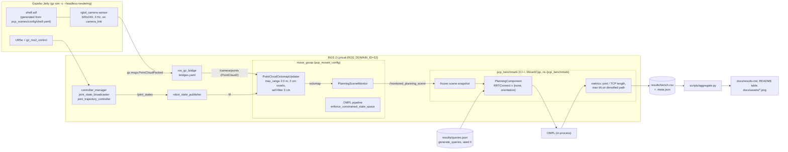

# Architecture

Language split: **C++17** for everything on the planning path (the benchmark node, constraint
builder, query generator, metrics; MoveIt and OMPL themselves); **Python** only for launch files,
the smoke-test orchestrator, the shelf-world generator and `scripts/aggregate.py` (tables and
plots). The planner never runs through Python.

## Nodes, topics and data flow

## Why it is wired this way

- **One octomap owner.** `move_group` runs the only `PointCloudOctomapUpdater`; the benchmark node
  receives the map through `/monitored_planning_scene`. RViz, the smoke test and the benchmark
  therefore see the same map, and the CPU pays for one updater. This needs care: MoveItCpp's
  planning-scene monitor starts a world-geometry monitor of its own, so if the benchmark node is
  given the `sensors_3d` parameters it silently builds a second octomap from the same camera.
  It was, until a 5 cm resolution sweep recorded a 2 cm octree in the benchmark's snapshot;
  `benchmark.launch.py` now strips those parameters, and every run records the snapshot's octree
  resolution in its `.meta.json`.
- **Frozen snapshot.** The benchmark waits until the number of occupied voxels has not changed for
  3 s, clones the planning scene once, and passes that clone to every
  `PlanningComponent::plan(params, scene)` call. All 200 cells see the identical map, so differences
  between constraint types are not differences between octomap updates.
- **Own namespace.** MoveItCpp's planning-scene monitor publishes its scene on the relative topic
  `planning_scene`. In the root namespace that is `/planning_scene`, which `move_group` applies as a
  diff, which it then republishes on `/monitored_planning_scene`, which MoveItCpp applies, and so on.
  The node runs in `/pcp_benchmark` with `monitored_planning_scene` and `joint_states` remapped to the
  global topics.
- **Queries without a ROS graph.** `generate_queries` is a plain C++ program: URDF + SRDF + shelf
  YAML + seed in, JSON out. That is what makes the determinism test possible (the test runs the same
  function and compares to the committed file byte for byte).
- **One shelf definition.** `pcp_scenes/config/shelf.yaml` drives both the Gazebo world (through
  `make_world.py`, checked by a test) and the generator's collision model.
- **Teardown.** Every script that starts Gazebo goes through `scripts/with_sim.sh`, which starts the
  launch in its own process group, kills the whole group afterwards and fails if anything survives.

## Frames

`world` is the root of the URDF (UR base at the origin). `camera_link` is fixed to `world` at
(−0.5, −0.6, 1.3) m looking at the shelf; the Gazebo point cloud arrives in `camera_link`
(x forward), which was checked by transforming a live cloud into `world` (45 % of points within
1.5 cm of a shelf box, 44 % on the floor, the rest on the arm). The octomap frame is `world`.
