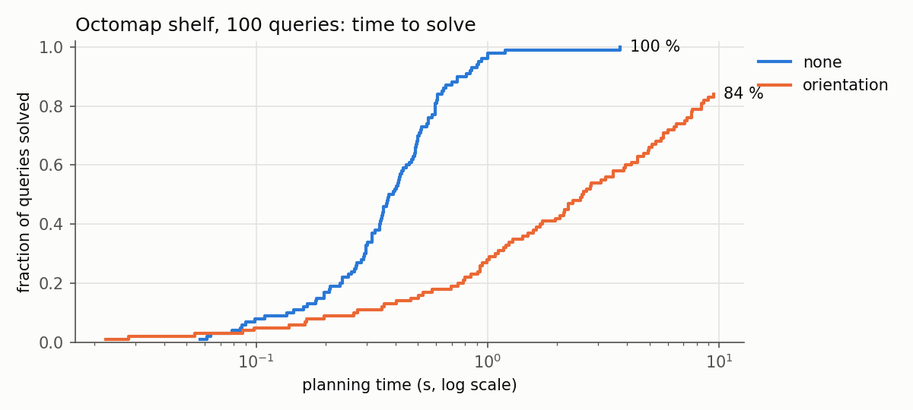
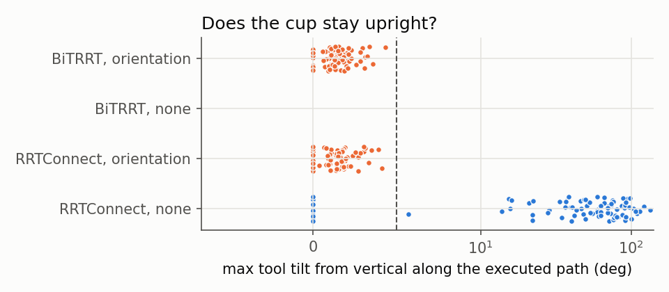

# Results

<!-- GENERATED by scripts/aggregate.py from results/bench.csv + results/bench_bitrrt.csv; do not edit by hand. -->

Every number here comes from `results/bench.csv + results/bench_bitrrt.csv` through `scripts/aggregate.py`. Regenerate the CSV with
`flock ~/work/.locks/gazebo.lock scripts/bench_planners.sh` (or the whole set with
`scripts/regenerate_all.sh`), then run `scripts/aggregate.py`.

Source: `results/bench.csv + results/bench_bitrrt.csv` (400 rows, 100 queries, commit `00e1d72`, query seed 0, OMPL seed 1, modes `constrained_state_space`, `joint_space`, 10 s per cell, octomap 4747 occupied 2 cm voxels, total wall time 8.2 min).

## Planner × constraint (feature prompt step 6)

| Planner | Constraint | Success (95 % Wilson CI) | Planning time median / p95 (s) | Joint path median (rad) | TCP path median (m) | Max tool tilt median / worst (deg) | Executed path collision-free (dense check) |
|---|---|---|---|---|---|---|---|
| RRTConnect (range 2 rad) | none | 100/100 = 100 % (96 %–100 %) | 0.375 / 0.781 | 4.94 | 1.10 | 54.5 / 133.7 | 94/100 |
| RRTConnect (range 2 rad) | orientation | 79/100 = 79 % (70 %–86 %) | 2.215 / 7.348 | 5.86 | 1.80 | 1.4 / 4.1 | 79/79 |
| BiTRRT (range 2 rad) | none | 0/100 = 0 % (0 %–4 %) | – / – | – | – | – / – | not recorded |
| BiTRRT (range 2 rad) | orientation | 83/100 = 83 % (74 %–89 %) | 2.195 / 8.591 | 5.34 | 1.47 | 1.3 / 4.3 | 82/83 |

- *Success* = MoveIt returned a trajectory that passed the `ValidateSolution` response adapter
  (collision-free against the frozen octomap snapshot and, for `orientation`, inside the path
  constraint at every waypoint) within the 10 s budget. Wilson 95 % intervals.
- *Planning time* and *path lengths* are over successful cells only. Planning time is MoveIt's
  `MotionPlanResponse::planning_time` (OMPL solve + simplification); failed cells leave it empty.
- *Executed path collision-free*: of the successful trajectories, how many stay collision-free
  against the snapshot when the time-parameterized trajectory is re-checked at 0.01 rad joint
  steps (`ValidateSolution` only checks waypoints).
- *Max tool tilt* is the angle between `tool0`'s z axis and world −z, evaluated on the path
  densified to 0.01 rad joint steps (what a joint trajectory controller executes between
  waypoints). The `orientation` constraint allows at most 5° (see docs/planners.md).
- Queries whose start or goal collides with the octomap snapshot: none 0, orientation 0, none 0, orientation 0.

## By query class

How the start and goal compartments relate (same compartment, across the central divider,
across the middle board, or diagonal).

| Query class | Planner | Constraint | Success (95 % Wilson CI) | Planning time median (s) |
|---|---|---|---|---|
| across board | BiTRRT (range 2 rad) | none | 0/29 = 0 % (0 %–12 %) | – |
| across board | BiTRRT (range 2 rad) | orientation | 26/29 = 90 % (74 %–96 %) | 1.598 |
| across board | RRTConnect (range 2 rad) | none | 29/29 = 100 % (88 %–100 %) | 0.330 |
| across board | RRTConnect (range 2 rad) | orientation | 24/29 = 83 % (65 %–92 %) | 1.727 |
| across divider | BiTRRT (range 2 rad) | none | 0/22 = 0 % (0 %–15 %) | – |
| across divider | BiTRRT (range 2 rad) | orientation | 16/22 = 73 % (52 %–87 %) | 2.559 |
| across divider | RRTConnect (range 2 rad) | none | 22/22 = 100 % (85 %–100 %) | 0.515 |
| across divider | RRTConnect (range 2 rad) | orientation | 17/22 = 77 % (57 %–90 %) | 3.490 |
| diagonal | BiTRRT (range 2 rad) | none | 0/31 = 0 % (0 %–11 %) | – |
| diagonal | BiTRRT (range 2 rad) | orientation | 23/31 = 74 % (57 %–86 %) | 3.697 |
| diagonal | RRTConnect (range 2 rad) | none | 31/31 = 100 % (89 %–100 %) | 0.483 |
| diagonal | RRTConnect (range 2 rad) | orientation | 23/31 = 74 % (57 %–86 %) | 2.755 |
| same compartment | BiTRRT (range 2 rad) | none | 0/18 = 0 % (0 %–18 %) | – |
| same compartment | BiTRRT (range 2 rad) | orientation | 18/18 = 100 % (82 %–100 %) | 0.021 |
| same compartment | RRTConnect (range 2 rad) | none | 18/18 = 100 % (82 %–100 %) | 0.139 |
| same compartment | RRTConnect (range 2 rad) | orientation | 15/18 = 83 % (61 %–94 %) | 0.340 |

## How RRTConnect's range was chosen (tuning set, not the evaluation set)

20 queries generated with seed 1 (`results/tuning/queries_seed1.json`), disjoint from the seed-0 evaluation queries, orientation constraint only, four `range` settings. The best success rate (ties: lower median time) became the benchmark planner configuration. Run before db74fcc, when the benchmark node built its own octomap from the same camera with identical settings (4747 voxels, the same count as move_group's map).

Source: `results/tuning/tuning.csv` (80 rows, commit `ca8deb5`).

| Planner | Constraint | Success (95 % Wilson CI) | Planning time median / p95 (s) | Joint path median (rad) | TCP path median (m) | Max tool tilt median / worst (deg) | Executed path collision-free (dense check) |
|---|---|---|---|---|---|---|---|
| RRTConnect (range 0.5 rad) | orientation | 4/20 = 20 % (8 %–42 %) | 0.538 / 1.356 | 1.63 | 0.24 | 0.0 / 0.1 | 4/4 |
| RRTConnect (range 1 rad) | orientation | 6/20 = 30 % (15 %–52 %) | 0.168 / 7.781 | 1.98 | 0.32 | 0.2 / 2.6 | 6/6 |
| RRTConnect (range 2 rad) | orientation | 11/20 = 55 % (34 %–74 %) | 2.305 / 7.280 | 4.99 | 2.01 | 1.1 / 2.7 | 11/11 |
| RRTConnect (auto range, 13.8 rad) | orientation | 1/20 = 5 % (1 %–24 %) | 7.116 / 7.116 | 16.75 | 3.51 | 2.7 / 2.7 | 1/1 |

Failures by MoveIt error code: orientation code -6: 58.

## How BiTRRT's range was chosen (tuning set)

Same protocol as for RRTConnect: the 20 seed-1 tuning queries, orientation constraint only, three `range` settings; the highest success rate became the BiTRRT column. Run before db74fcc, when the benchmark node built its own octomap from the same camera with identical settings (4747 voxels, the same count as move_group's map).

Source: `results/tuning/tuning_bitrrt.csv` (60 rows, commit `dfb0119`).

| Planner | Constraint | Success (95 % Wilson CI) | Planning time median / p95 (s) | Joint path median (rad) | TCP path median (m) | Max tool tilt median / worst (deg) | Executed path collision-free (dense check) |
|---|---|---|---|---|---|---|---|
| BiTRRT (range 2 rad) | orientation | 14/20 = 70 % (48 %–85 %) | 1.724 / 9.046 | 6.20 | 1.95 | 2.0 / 2.9 | 14/14 |
| BiTRRT (range 6 rad) | orientation | 9/20 = 45 % (26 %–66 %) | 1.082 / 7.536 | 7.79 | 2.50 | 2.5 / 3.8 | 8/9 |
| BiTRRT (auto range, 13.8 rad) | orientation | 13/20 = 65 % (43 %–82 %) | 1.510 / 9.001 | 6.88 | 2.30 | 2.2 / 3.4 | 13/13 |

Failures by MoveIt error code: orientation code -6: 24.

## Octomap resolution sweep: 2 cm (first 20 evaluation queries)

SHOULD item. The first 20 seed-0 queries with the benchmark planner, octomap voxels of 2 cm (the default) in a fresh simulation; compare with the 5 cm section below.

Source: `results/sweep/octomap_0.02.csv` (40 rows, commit `426a525`).

| Planner | Constraint | Success (95 % Wilson CI) | Planning time median / p95 (s) | Joint path median (rad) | TCP path median (m) | Max tool tilt median / worst (deg) | Executed path collision-free (dense check) |
|---|---|---|---|---|---|---|---|
| RRTConnect (range 2 rad) | none | 20/20 = 100 % (84 %–100 %) | 0.360 / 0.755 | 4.66 | 1.47 | 48.8 / 144.0 | 20/20 |
| RRTConnect (range 2 rad) | orientation | 15/20 = 75 % (53 %–89 %) | 1.906 / 5.314 | 4.94 | 1.81 | 1.4 / 2.4 | 15/15 |

Failures by MoveIt error code: orientation code -6: 5.

## Octomap resolution sweep: 5 cm (first 20 evaluation queries)

Same 20 queries, octomap voxels of 5 cm. Coarser voxels inflate obstacles by up to a voxel, which eats the generator's 3 cm clearance; `start_valid`/`goal_valid` in the CSV show how many queries become invalid.

Source: `results/sweep/octomap_0.05.csv` (40 rows, commit `426a525`).

| Planner | Constraint | Success (95 % Wilson CI) | Planning time median / p95 (s) | Joint path median (rad) | TCP path median (m) | Max tool tilt median / worst (deg) | Executed path collision-free (dense check) |
|---|---|---|---|---|---|---|---|
| RRTConnect (range 2 rad) | none | 10/20 = 50 % (30 %–70 %) | 0.372 / 0.705 | 5.57 | 1.41 | 59.3 / 99.5 | 10/10 |
| RRTConnect (range 2 rad) | orientation | 9/20 = 45 % (26 %–66 %) | 3.340 / 7.373 | 7.65 | 2.63 | 1.6 / 3.9 | 9/9 |

Failures by MoveIt error code: none code -10: 6, none code -27: 4, orientation code -10: 6, orientation code -27: 4, orientation code -6: 1.

## Ablation: collision-check resolution 0.005 (MoveIt's usual value)

The same 100 evaluation queries with the first configuration: `longest_valid_segment_fraction: 0.005`, OMPL's automatic range, time parameterization before `ValidateSolution` (0.1 rad blending), keep-upright reference yaw fixed at 0, OMPL seed 0. On the UR5e's 69 rad extent 0.005 means a collision check only every 0.35 rad; the unconstrained failures here are `ValidateSolution` rejections (error -2), not planner timeouts. Run before db74fcc, when the benchmark node built its own octomap from the same camera with identical settings (4747 voxels, the same count as move_group's map).

Source: `results/ablation/bench_lvsf0.005.csv` (200 rows, commit `6c12eeb`).

| Planner | Constraint | Success (95 % Wilson CI) | Planning time median / p95 (s) | Joint path median (rad) | TCP path median (m) | Max tool tilt median / worst (deg) | Executed path collision-free (dense check) |
|---|---|---|---|---|---|---|---|
| RRTConnect (auto range, 13.8 rad) | none | 83/100 = 83 % (74 %–89 %) | 0.062 / 0.202 | 7.73 | 1.80 | 90.7 / 178.0 | not recorded |
| RRTConnect (auto range, 13.8 rad) | orientation | 12/100 = 12 % (7 %–20 %) | 3.781 / 7.700 | 4.23 | 1.59 | 1.0 / 4.4 | not recorded |

Failures by MoveIt error code: none code -2: 17, orientation code -6: 88.

## Regenerate

| Benchmark | Metric | Value | Regenerate with |
|---|---|---|---|
| shelf, RRTConnect (range 2 rad), none | success rate | 100 % | `scripts/bench_planners.sh && scripts/aggregate.py` |
| shelf, RRTConnect (range 2 rad), orientation | success rate | 79 % | `scripts/bench_planners.sh && scripts/aggregate.py` |
| shelf, BiTRRT (range 2 rad), none | success rate | 0 % | `scripts/bench_planners.sh && scripts/aggregate.py` |
| shelf, BiTRRT (range 2 rad), orientation | success rate | 83 % | `scripts/bench_planners.sh && scripts/aggregate.py` |
| How RRTConnect's range was chosen, RRTConnect (range 0.5 rad), orientation | success rate | 20 % | `scripts/bench_planners.sh 20 results/tuning/tuning.csv results/tuning/queries_seed1.json results/tuning/tuning.yaml` |
| How RRTConnect's range was chosen, RRTConnect (range 1 rad), orientation | success rate | 30 % | `scripts/bench_planners.sh 20 results/tuning/tuning.csv results/tuning/queries_seed1.json results/tuning/tuning.yaml` |
| How RRTConnect's range was chosen, RRTConnect (range 2 rad), orientation | success rate | 55 % | `scripts/bench_planners.sh 20 results/tuning/tuning.csv results/tuning/queries_seed1.json results/tuning/tuning.yaml` |
| How RRTConnect's range was chosen, RRTConnect (auto range, 13.8 rad), orientation | success rate | 5 % | `scripts/bench_planners.sh 20 results/tuning/tuning.csv results/tuning/queries_seed1.json results/tuning/tuning.yaml` |
| How BiTRRT's range was chosen, BiTRRT (range 2 rad), orientation | success rate | 70 % | `scripts/bench_planners.sh 20 results/tuning/tuning_bitrrt.csv results/tuning/queries_seed1.json results/tuning/tuning_bitrrt.yaml` |
| How BiTRRT's range was chosen, BiTRRT (range 6 rad), orientation | success rate | 45 % | `scripts/bench_planners.sh 20 results/tuning/tuning_bitrrt.csv results/tuning/queries_seed1.json results/tuning/tuning_bitrrt.yaml` |
| How BiTRRT's range was chosen, BiTRRT (auto range, 13.8 rad), orientation | success rate | 65 % | `scripts/bench_planners.sh 20 results/tuning/tuning_bitrrt.csv results/tuning/queries_seed1.json results/tuning/tuning_bitrrt.yaml` |
| Octomap resolution sweep, RRTConnect (range 2 rad), none | success rate | 100 % | `scripts/bench_octomap_resolution.sh 20 0.02 0.05` |
| Octomap resolution sweep, RRTConnect (range 2 rad), orientation | success rate | 75 % | `scripts/bench_octomap_resolution.sh 20 0.02 0.05` |
| Octomap resolution sweep, RRTConnect (range 2 rad), none | success rate | 50 % | `scripts/bench_octomap_resolution.sh 20 0.02 0.05` |
| Octomap resolution sweep, RRTConnect (range 2 rad), orientation | success rate | 45 % | `scripts/bench_octomap_resolution.sh 20 0.02 0.05` |
| Ablation, RRTConnect (auto range, 13.8 rad), none | success rate | 83 % | `git checkout 6c12eeb && scripts/bench_planners.sh 100 results/ablation/bench_lvsf0.005.csv` |
| Ablation, RRTConnect (auto range, 13.8 rad), orientation | success rate | 12 % | `git checkout 6c12eeb && scripts/bench_planners.sh 100 results/ablation/bench_lvsf0.005.csv` |

## Plots

<!-- direct:start -->
<!-- GENERATED by scripts/aggregate_direct.py; do not edit by hand. -->

## v0.2: direct OMPL + coal pipeline vs MoveIt 2 (same queries, boxes, settings, controller)

| Metric | Direct (OMPL + coal) | MoveIt 2 (MoveItCpp) | Like for like? |
|---|---|---|---|
| Planned (Wilson 95 %) | 100/100 = 100 % (96 %–100 %) | 100/100 = 100 % (96 %–100 %) | yes |
| **OMPL solve + simplification**, median / p95 (s) | 0.402 / 1.039 | 0.123 / 0.274 | **yes**: MoveIt's `planning_time` is solve + simplify |
| OMPL solve only, median / p95 (s) | 0.081 / 0.531 | inside `planning_time` | direct only |
| Simplification, median / p95 (s) | 0.320 / 0.688 | inside `planning_time` | direct only |
| Time parameterisation, median / p95 (s) | 0.000025 / 0.000047 | inside `plan()` (TOTG adapter) | no: trapezoid vs TOTG |
| **Request → time-parameterised trajectory**, median / p95 (s) | 0.402 / 1.040 | 0.169 / 0.471 | **yes**: wall time, same process |
| Validity checks per request, median / p95 | 7668 / 19644 | not exposed | direct only |
| Collision check inside the planner, median over 20 probe queries (µs) | 48.6 | 12.4 | yes: same queries, each measured inside its own planner (probe) |
| Trajectory duration, median / p95 (s) | 3.85 / 6.60 | 3.14 / 5.61 | no: rest-to-rest trapezoids vs TOTG on the interpolated path |
| Joint path length, median (rad) | 4.71 | 4.51 | yes (same metric) |
| TCP path length, median (m) | 1.18 | 1.13 | yes (same metric) |
| Path clean for the OTHER pipeline's checker at 0.01 rad (cross-validation) | 97/100 | 91/100 | yes |
| Path clean for its OWN checker at 0.01 rad | 97/100 | 91/100 | yes (a failure here is a discretisation miss, not a checker disagreement) |
| Executed and reached the goal (≤ 0.01 rad) | 100/100 = 100 % (96 %–100 %) | 99/100 = 99 % (95 %–100 %) | yes: same controller |
| Execution time, median / p95 (sim s) | 3.87 / 6.61 | 3.18 / 5.60 | no: follows the trajectory duration; MoveIt adds its execution manager |
| Max joint tracking error, median / p95 (rad) | 0.0330 / 0.0538 | 0.0457 / 0.0578 | yes: same controller, same measurement |

Source: `results/bench_direct.csv` (200 rows, 100 queries, 0 skipped, commit `5432d60`, query seed 0, OMPL seed 1 (direct only), with execution, 10 s per plan, total wall time 28.2 min). Direct: RRTConnectRange2, range 2.00 rad, check every 0.0207 rad (extent 69.12 rad). MoveIt's configured context: range 2, check every 0.0207 rad (extent 69.12 rad).

- Paired, on the 100 queries both planned: the direct pipeline's solve +
  simplify time is 3.25× MoveIt's
  `planning_time` (median of per-query ratios); it is faster on 0.
- Simplification took longer than the OMPL solve on 93 of
  100 direct plans.
- Skipped queries (start or goal rejected by either checker): 0.
- Repositioning moves (direct planner, to each run's start): 200
  attempted, 0 failed.

### Where the planning time goes (probe)

MoveIt's `planning_time` hides its internals, so a separate probe solves the first queries again
in the OMPL planning context MoveIt builds for `plan()`, with MoveIt's own validity checker
subclassed to count and time every call, and with the direct planner
(`scripts/check_probe.sh 20`, one query per process; the pipeline's adapters are bypassed).

| Median over 20 queries | Direct planner | MoveIt's planner core |
|---|---|---|
| Validity checks per request | 9564 | 8768 |
| Time per check inside the planner (µs) | 48.6 | 12.4 |
| OMPL solve (s) | 0.109 | 0.029 |
| Simplification (s) | 0.396 | 0.080 |
| Share of solve + simplify spent in the checker | 99.6 % | 92.5 % |

### Keep-upright in both pipelines (SHOULD)

The direct planner gets v0.1's constraint as an `ompl::base::Constraint` (the rotation vector of
R_tool^T R_target with per-axis dead bands, co-dimension 3, as MoveIt formulates it) on OMPL's
`ProjectedStateSpace`; MoveIt gets v0.1's `OrientationConstraint` with
`enforce_constrained_state_space`. Plan only, same queries.

| Keep-upright (5°), plan only | Direct (OMPL + coal) | MoveIt 2 (MoveItCpp) |
|---|---|---|
| Planned (Wilson 95 %) | 58/100 = 58 % (48 %–67 %) | 88/100 = 88 % (80 %–93 %) |
| OMPL solve + simplification, median / p95 (s) | 4.025 / 9.096 | 1.047 / 7.090 |
| Request → trajectory, median / p95 (s) | 4.025 / 9.096 | 1.068 / 7.123 |
| Max tool tilt along the path, median / worst (deg) | 0.7 / 1.8 | 1.5 / 3.2 |
| Path clean for the other pipeline's checker | 58/58 | 85/88 |

Source: `results/bench_direct_upright.csv` (200 rows, commit `1d8e13a`, 10 s per plan, total wall time 16.3 min).

### Both pipelines on move_group's octomap (SHOULD)

The direct checker reads the octomap MoveIt built from the simulated camera (`world.octomap` of
the frozen scene's message, `octomap_msgs::msgToMap`, since MoveIt writes a full rather than
binary map) as one `coal::OcTree`, so both pipelines plan on
the identical map and the v0.1 query set (`queries.json` = `queries_boxes.json`) is reused.
Plan only, unconstrained (`scripts/bench_direct.sh 100 results/bench_direct_octomap.csv
--octomap`).

| Octomap scene, plan only | Direct (OMPL + coal) | MoveIt 2 (MoveItCpp) |
|---|---|---|
| Planned (Wilson 95 %) | 100/100 = 100 % (96 %–100 %) | 100/100 = 100 % (96 %–100 %) |
| OMPL solve + simplification, median / p95 (s) | 0.473 / 1.025 | 0.367 / 0.775 |
| Collision check, median (µs) | 52.3 | not exposed |
| Path clean for the other pipeline's checker / its own (0.01 rad) | 96 / 96 of 100 | 92 / 92 of 100 |

Source: `results/bench_direct_octomap.csv` (200 rows, 0 queries skipped because a start or goal collides with the map for either checker, commit `bba7c00`, 4747 occupied 2 cm leaves, total wall time 1.8 min).

### Collision agreement (MoveIt's planning scene vs the direct checker)

**500/500 = 100.00 %** of seeded uniform configurations (seed 0, 343 colliding) get the same verdict from MoveIt's planning scene (FCL) and the direct checker (coal through Pinocchio), using the request MoveIt's OMPL validity checker sends (arm group, no padding). Both check the same 62 pairs (MoveIt's ACM and group rules derived independently: equal = True), name identical colliding pairs on every configuration, and report the same minimum distance to the printed 1e-6 m on the free ones. That agreement is less independent than it looks: coal is a fork of FCL (through hpp-fcl), so the two share their BVH and GJK algorithms. Uniform samples never come within millimetres of contact, so a boundary probe bisects every verdict change between consecutive samples to a 1e-7 rad bracket: **180/194** brackets agree. All 14 differences are on forearm_link/wrist_3_link, where FCL measures 1–5 nm of separation and coal reports contact: hundreds of times below coal's GJK tolerance (1e-6 m) and Pinocchio's `distance_upper_bound` (1e-6 m), so either verdict is inside the libraries' stated precision. Nothing was tuned to raise these numbers. On these random configurations (two thirds colliding, so both stop early; cold caches) a check including forward kinematics takes 48.9 µs in MoveIt and 61.2 µs in the direct checker (median). Inside the planners, where most states are free, the gap is wider (the probe below): Pinocchio tests every active pair in a loop, while MoveIt's FCL environment runs a broadphase first.

Files: `results/collision_agreement.csv` (+ `.meta.json`),
`results/collision_agreement_boundary.csv`.

### Regenerate (v0.2)

| Benchmark | Regenerate with |
|---|---|
| Collision agreement (500 configurations + boundary probe) | `scripts/collision_agreement.sh 500` |
| Direct vs MoveIt, 100 queries with execution | `scripts/bench_direct.sh 100 && scripts/aggregate_direct.py` |
| CI mini-benchmark, 5 queries, plan only | `scripts/bench_direct.sh 5 results/tmp/ci_direct5.csv --plan-only` |
| Check-count probe, 20 queries | `scripts/check_probe.sh 20` |
| Keep-upright, both pipelines, 100 queries, plan only | `PCP_CONSTRAINT=orientation scripts/bench_direct.sh 100 results/bench_direct_upright.csv --plan-only` |
| Octomap scene, both pipelines, 100 queries, plan only | `scripts/bench_direct.sh 100 results/bench_direct_octomap.csv --octomap` |

<!-- direct:end -->
